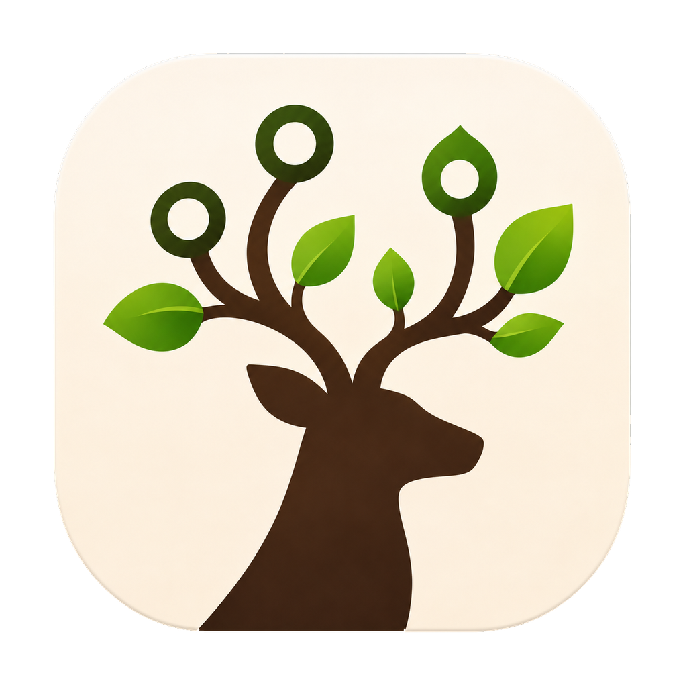
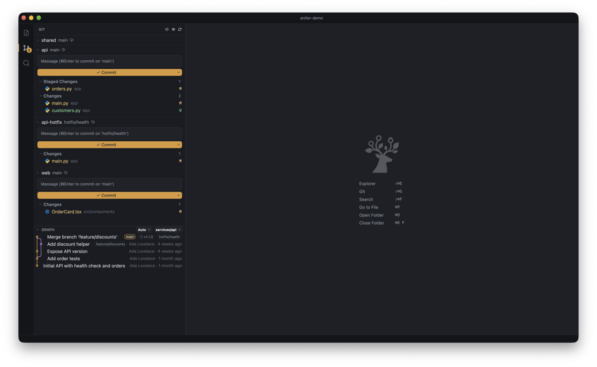
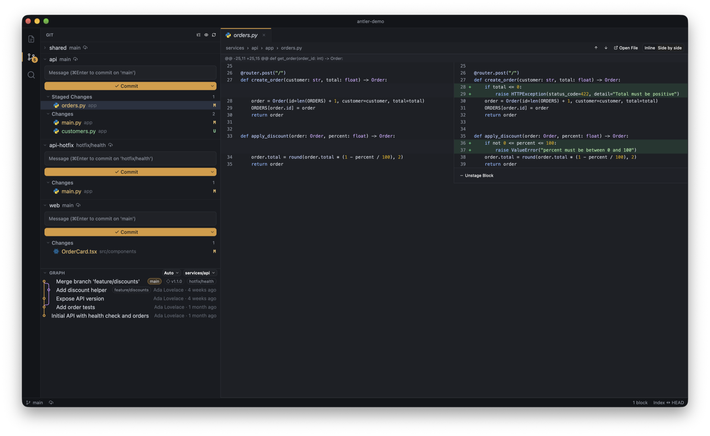
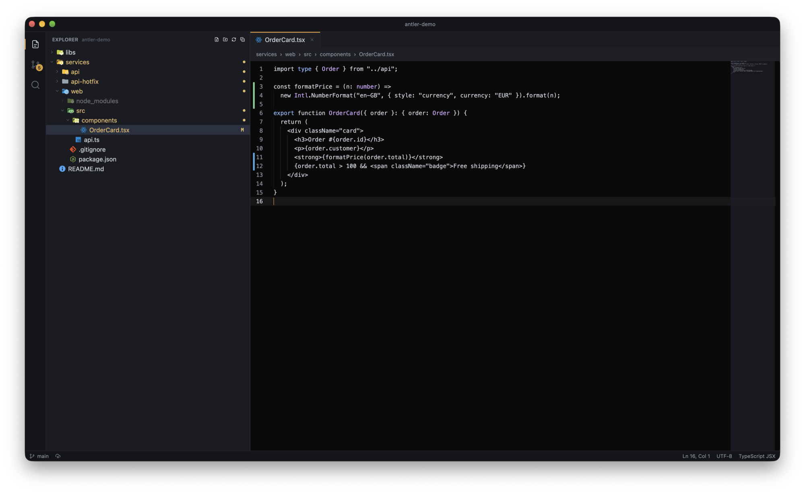

<p align="center"></p>

# Antler

A fast, lightweight macOS editor that shows every git repository under a folder in one panel: browse, edit, review diffs, stage and commit across all of them.

Built in Rust on [GPUI](https://github.com/zed-industries/zed/tree/main/crates/gpui). Aimed at developers who work in folders with many nested repositories, and at anyone reviewing changes that code agents have made across them.

## Screenshots







## Install

With Homebrew (installs `Antler.app` and the `antler` command):

```sh
brew install --cask gianmadd/tap/antler
```

Or download `Antler-<version>-arm64.zip` from the [Releases](https://github.com/gianmadd/antler/releases) page and move `Antler.app` to `/Applications`.

Or build from source (requirements below):

```sh
scripts/bundle.sh --install
```

This builds in release mode, creates an ad-hoc signed `Antler.app`, copies it to `/Applications` (asking first if it exists; `--yes` skips the question) and installs the `antler` command in `~/.local/bin`. Re-run it to update. Without `--install` it only creates `target/bundle/Antler.app`; `--zip` also makes the release zip.

**First launch:** Antler is not notarized yet, so macOS blocks it the first time. Open System Settings, Privacy & Security, and click "Open Anyway", or run `xattr -dr com.apple.quarantine /Applications/Antler.app`.

## Usage

```sh
antler [folder]
```

- `folder`: the folder to open. Without it, Antler shows a window with "Open Folder…" (Cmd+O).
- One app, many windows: with Antler running, `antler folder` opens a window in it, or brings forward the window that already shows that folder. New Window is ⇧⌘N, Close Window ⇧⌘W; at the next start every window comes back (`window.restoreWindows`).

## Building from source

- macOS on Apple Silicon.
- Full Xcode (not only the Command Line Tools) with the Metal Toolchain: `xcodebuild -downloadComponent MetalToolchain`.
- Rust via [rustup](https://rustup.rs) (stable).

```sh
cargo run --release -- ~/path/to/folder
cargo test
```

## Project status

Young and moving fast. macOS on Apple Silicon only, for now. Releases are published on GitHub (`v0.x`) and are ad-hoc signed.

## Contributing

- [`AGENTS.md`](AGENTS.md): how to work on the project.
- [`GLOSSARY.md`](GLOSSARY.md): the domain vocabulary.
- [`docs/adr/`](docs/adr/): architecture decisions.

## License

Licensed under either of [MIT](LICENSE-MIT) or [Apache-2.0](LICENSE-APACHE) at your option.

The built-in file icon theme is Seti, from [Visual Studio Code](https://github.com/microsoft/vscode/tree/main/extensions/theme-seti) (MIT) and [seti-ui](https://github.com/jesseweed/seti-ui) (MIT, Jesse Weed); see `assets/seti/ThirdPartyNotices.txt`. Other icon and color themes install from a `.vsix` (for example from [Open VSX](https://open-vsx.org/?category=Themes)) and keep their own licenses.
